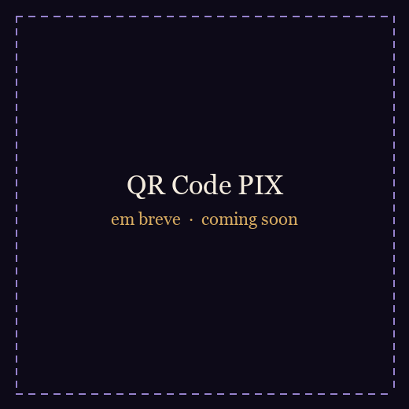

<p align="center">
  
</p>

<p align="center">
  <a href="README.md">Português</a> &nbsp;·&nbsp; <b>English</b>
</p>

<p align="center">
  
  
  
  
</p>

# Harpia

**Harpia** runs *The Legend of Zelda: Ocarina of Time* (Nintendo Switch 2 version) **natively on Windows, with no emulator**, from **your own copy of the game**.

It is not an emulator: the game's code is translated to C **once, on your PC**, and compiled as an ordinary Windows program (static recompilation). The console's system software is reimplemented and the Switch 2's graphics are redone on Vulkan.

> [!IMPORTANT]
> ### Legal notice
> - This repository **does not contain the game**, any part of it, any keys, or a ready-made executable. Everything the build produces (`harpia.exe`, generated code, shader caches, saves) is derived from **your** game and stays **on your PC**. **Never share those files.**
> - You need **a legitimately obtained copy of the game**, dumped by you from your own console. This project **does not explain how to obtain the game**, decrypts nothing, and neither asks for nor accepts keys.
> - Harpia is an unofficial fan project, **not affiliated with or endorsed by Nintendo**. *The Legend of Zelda* and *Ocarina of Time* are trademarks of Nintendo; all other names belong to their owners.
> - Requests for help that involve pirating the game will be closed without a reply.

## Contents

[What it is](#what-it-is-and-whose-work-it-is) · [Current status](#current-status) · [Requirements](#requirements) · [From your file to the game](#from-your-file-to-the-game) · [Playing and the F1 menu](#playing-and-the-f1-menu) · [Known issues](#known-issues) · [Roadmap](#roadmap) · [How it works](#how-it-works) · [Contributing and help](#contributing-getting-help-and-reporting-bugs) · [Credits](#credits-and-thanks) · [License](#license) · [Support the project](#support-the-project)

## What it is and whose work it is

Harpia is a **personal version, with its own identity**, of the open-source **[Hookshot](https://github.com/NotRexed/Hookshot)** project (GPL-3.0-or-later) by **NotRexed and contributors**. **Almost all of the heavy lifting comes from it**: the ARM64-to-C translator, the reimplemented Horizon system, the NVN2 graphics layer and the shader recompiler. Without that project Harpia would not exist; see the [full credits](CREDITS.en.md).

What Harpia adds on top of the base:

- a **tabbed options menu in Portuguese and English** (F1): upscaling, aspect ratio, filtering and frame pacing;
- **AMD FSR 1** and **NVIDIA NIS** upscalers, besides Linear, Catmull-Rom and Lanczos;
- a **sturdier shader cache** that survives program updates instead of starting over;
- shader-translator fixes and a **dark-frame detector** to hunt the flashes;
- CPU performance work and fixes for AMD cards;
- the **Harpia Builder**, a windowed app that turns your game file into a playable folder;
- ongoing integration and testing of improvements from other projects, always keeping their credit notices.

The code of every change lives in this repository, under the same licence as the base.

## Current status

Harpia is **under active development**. The game runs and is playable; rough edges remain (see [Known issues](#known-issues)). **There is no installer or ready-to-download release yet.**

| Feature | Status |
|---|---|
| Native Windows game, Vulkan 1.3 | Works |
| Tabbed menu (F1), in pt-BR and English | Works |
| FSR 1 and NIS upscalers, Catmull-Rom, Lanczos | Works |
| Aspect ratio (stretch, fit 16:9, fill), fullscreen, VSync | Works |
| Anisotropic filtering (2x to 16x) | Works |
| Texture quality (Normal and High) | Works |
| Frame generation (2x to 8x) | Works; may flicker on fast motion |
| Shader cache that survives updates | Works |
| Dark-frame detector (diagnostic) | Works |
| Rebindable controls (keyboard and gamepad) | Works |
| **Native 2.5K resolution** (2560x1440) and "Ultra" textures | **In progress** (tested on a development branch, not yet integrated) |
| **DLSS** | **In progress** (analysis done, code not yet tested on a GPU) |
| Installer / ready-made Builder package | Planned |

## Requirements

- **Windows 10 or 11, 64-bit.**
- **A graphics card with Vulkan 1.3** (the game uses mesh shaders: cards with `VK_EXT_mesh_shader` are the target), with an up-to-date driver. Development and testing are done mainly on an **NVIDIA GeForce RTX 5080**; there are AMD fixes made from reports, and Intel GPUs have not been tested.
- **16 GB of RAM or more** and about **60 GB free** during the build.
- **Visual Studio Build Tools** with the "Desktop development with C++" workload (compiler and Windows SDK).
- **Your copy of the game, in the supported version:** program `0400486024DEC000`, update `v131072`, build `e0f3ccfa`. Other versions are rejected with a clear message.
- To build from source (rather than through the packaged Builder): Python 3 with `lz4`, `numpy`, `capstone` and `zstandard` (and `unicorn` 2.1 only for the instruction tests), plus emsdk's clang. Details in [docs/development.md](docs/development.md).

> [!NOTE]
> The repository stores no binaries. Pre-built tools (`SDL2.dll`, `wgpu-native`) and headers fetched during the build are not in git; the Builder package is meant to bring them (not published yet).

## From your file to the game

Harpia reads the game **already decrypted**, in one of two forms:

1. **A `.nup` file**: a package holding, for each title, the game's `exefs/` and `romfs/` trees. The newest title in the package is used.
2. **`romfs` and `exefs` folders**: the same thing, already extracted.

Both come from *a dump you made of your own game*. This project does not teach how to make the dump.

### With the Harpia Builder (window)

1. Open `HarpiaBuilder`, pick **.nup file** (or **romfs and exefs**) and point it at your files.
2. The Builder checks it is the right game and version, and says so in plain words when it is not.
3. Choose the destination folder (for example `C:\Games\Harpia`) and the game language (16 languages).
4. Wait: translation and compilation run on your PC and take a while. Progress is shown step by step.
5. Open `harpia.exe` in the folder it made.

### From the command line

```powershell
# only check the game version (needs the build tools already installed)
python -I nx2/make_game.py --check --nup "C:\path\your-game.nup"

# build the game folder
python -I nx2/make_game.py --nup "C:\path\your-game.nup" --out "C:\Games\Harpia" --language en-US
python -I nx2/make_game.py --romfs "C:\path\romfs" --exefs "C:\path\exefs" --out "C:\Games\Harpia" --language en-US
```

The working folder is `%LOCALAPPDATA%\HarpiaBuilder`. The output folder holds everything the game needs and starts with a double click; nothing goes back into the repository. To rebuild the folder after a Harpia update: `python -I nx2/make_game.py --update <game folder>` (it works only on folders made by a recent version, which keep a copy of the game files). The `--language` code must be one of the Builder's 16, such as `pt-BR` or `en-US`.

Something went wrong? See [SUPPORT.en.md](SUPPORT.en.md).

## Playing and the F1 menu

| Key | Action |
|---|---|
| <kbd>F1</kbd> or <kbd>Insert</kbd> | Options menu (gamepad: Back + Start, or Home; LB / RB switch tabs) |
| <kbd>F11</kbd> | Fullscreen |
| <kbd>W</kbd> <kbd>A</kbd> <kbd>S</kbd> <kbd>D</kbd> and arrows | Move (left stick) and turn the camera: fixed. The Controls tab binds the game's buttons |

Inside the menu: <kbd>Q</kbd> / <kbd>E</kbd> switch tab, <kbd>↑</kbd> <kbd>↓</kbd> choose, <kbd>←</kbd> <kbd>→</kbd> change the value.

| Tab | Options |
|---|---|
| **Display** | Fullscreen · Aspect ratio (Stretch / Fit 16:9 / Fill) · VSync (Off / On / Off with tearing) · FPS counter |
| **Graphics** | Render scale (Auto, 100% to 33%) · Upscaler (Linear, Catmull-Rom, Lanczos, AMD FSR 1, NVIDIA NIS) · Sharpness · Texture filtering (Game, 2x to 16x) · Texture quality (Normal / High) · Fog (Classic / Game's) · Console mode (Docked / Handheld) |
| **Performance** | Frame generation (off, 2x to 8x) · Frame pacing · Game speed (Per frame / Real time) |
| **Controls** | Bind gamepad buttons and keys |
| **Info** | Graphics card, output, keys and credits |

Some options (Aspect "Fill", Texture quality, Fog, Console mode) apply **after a restart**; the menu says so.

### Files created next to the game

| File | What it is |
|---|---|
| `harpia_options.ini` | menu and control options |
| `harpia_log.txt` | log of the last run (when started from the icon) |
| `harpia_programs.bin`, `harpia_pipelines.bin`, `harpia_vk_pipelines.bin`, `harpia_prepared.bin` | shader caches: safe to delete, they are rebuilt |
| `harpia_shaders.bin` | the game's shader list, prepared before playing |
| `harpia_env.txt` | optional: `NAME=VALUE` lines read as environment variables |
| `user\save` | your saves |
| `language.txt` | the game language code (for example `en-US`) |
| `image.bin`, `romfs\`, `.harpia_exefs` | **data from YOUR game**, used by the program: **never share them** |

Caches and the log **derive from the game or your PC**: do not attach them to reports without looking first (see [how to report](CONTRIBUTING.en.md#reporting-a-bug)).

## Known issues

- **Flashes:** now and then a frame comes out unlit (silhouettes). A detector exists (`RX_VK_DARKLOG`) and several causes have been ruled out; the root cause is still being investigated.
- **First-run stutter:** a new area's shaders are compiled during play. From the second run on, the cache avoids almost all of it.
- **Dark foliage in Kokiri** (ferns, vines): the original project's fix is included; visual verification continues.
- **GPU device loss** (*device lost*), rare, seen in development testing; a probable cause was fixed and the case remains under observation.
- **Frame generation** may flicker on fast motion, the HUD and camera cuts.
- Output stays at 2048x1152 for now (2.5K is work in progress).
- No ready-made installer; a Linux build exists in the code but is **not supported**.

Found another? See [how to report a bug](CONTRIBUTING.en.md#reporting-a-bug).

## Roadmap

**Done** (one step per commit in the history): upstream update (foliage, lighting, movies) · fix for pages freed during import to the GPU · sturdier shader cache (notes that survive changes, crash marker) · translator fixes and the dark-frame detector · CPU performance.

**In progress:** native 2.5K output resolution and "Ultra" textures · DLSS (feasible with camera-reconstructed motion vectors; NVIDIA's DLLs are proprietary and **will not be distributed** by the project) · background shader compilation · the cause of the flashes.

**Planned:** ready-made Harpia Builder package · colour adjustment and a performance panel · a Builder option to use more CPU and RAM to speed up installation · technical documentation in Portuguese.

## How it works

1. `nx2/lift.py` translates the game's ARM64 code to C.
2. `nx2/build.py` compiles that C together with `host/`, which plays the console's system.
3. `host/nvn_native.c` records the game's NVN2 graphics calls and `gpu/vk/` replays them on Vulkan.
4. The Switch 2's Ampere shaders are lowered to Maxwell and translated to SPIR-V by Eden's shader recompiler.

```
nx2/         translator, build and tools (Python)
host/        reimplemented console system (C)
gpu/vk/      Vulkan renderer and shader recompiler
builder/     Harpia Builder (WPF, .NET 8)
third_party/ third-party components, with their licences
docs/        technical design and images
tests/       tests that do not need the game
```

More in [docs/development.md](docs/development.md) and [docs/design.md](docs/design.md).

## Contributing, getting help and reporting bugs

- **Contribute:** [CONTRIBUTING.en.md](CONTRIBUTING.en.md) (building, branches, commits, GPU test rules and PRs).
- **I need help:** [SUPPORT.en.md](SUPPORT.en.md).
- **I found a bug:** [open an issue](../../issues/new/choose) with the bug template (GPU, driver, Windows, `harpia_options.ini` and a `harpia_log.txt` excerpt).
- **Security:** [SECURITY.md](SECURITY.md).
- **Conduct:** [CODE_OF_CONDUCT.md](CODE_OF_CONDUCT.md).

## Credits and thanks

Heartfelt thanks to those who did the hardest work:

- **NotRexed** and the contributors of **[Hookshot](https://github.com/NotRexed/Hookshot)**, the base of everything here (recompilation, system, NVN2, a64-kit).
- **Eden**, **yuzu/suyu** and **Eglantine**: the shader recompiler and the Switch 2 shader work.
- **sostenesfreitas/ocarina-recomp**, **Lichii**, **nxnative**, **MacNativeGames**, **TotK Recomp** and **dkb-pc-recomp**: open research and fixes that guide ours.
- **Ryujinx**, **zbic**, **AMD FidelityFX FSR** (MIT), **NVIDIA Image Scaling** (MIT), **SDL2**, **Vulkan Memory Allocator**, **Sirit**, **Opus** and many more.

The full list, with links and licences, is in **[CREDITS.en.md](CREDITS.en.md)** and [NOTICE.md](NOTICE.md). If your work is here and the credit is wrong or missing, open an issue: we will fix it right away.

## License

Harpia is free software under the **[GNU General Public License, version 3 or later](LICENSE)** (GPL-3.0-or-later), like the project it builds on. Third-party parts under other compatible licences keep their notices in their folders; see [NOTICE.md](NOTICE.md). The `(hookshot)` comments and `Hookshot issue/PR N` references in the sources are authorship and modification notices required by the licences: **do not remove them**.

## Support the project

Harpia is and will stay **free**. If you want to help keep development going, you can make a voluntary donation by **PIX** (Brazil's instant payment system):

<p align="center">
  
</p>

<!-- PIX: when the QR code image arrives, save it as docs/assets/pix-qrcode.png and change the src above. Optional: the "copy and paste" key as text, below. -->

> Donations are voluntary, **do not buy access, the game or priority support**, and have nothing to do with Nintendo. Please also consider supporting the projects that make Harpia possible (links in [CREDITS.en.md](CREDITS.en.md)).
