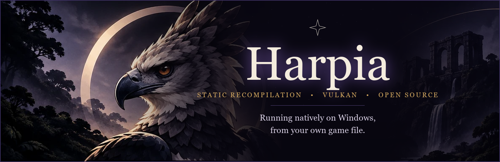

<p align="center">
  
</p>

<p align="center">
  <a href="README.md">Português</a> &nbsp;·&nbsp; <b>English</b>
</p>

<p align="center">
  
  
  
  
  
</p>

# Harpia

**Harpia** runs *The Legend of Zelda: Ocarina of Time* (Nintendo Switch 2 version) **natively on Windows, with no emulator**, from **your own copy of the game**.

It is not an emulator: the game's code is translated to C **once, on your PC**, and compiled as an ordinary Windows program (static recompilation). The console's system software is reimplemented and the Switch 2's graphics are redone on Vulkan.

> [!IMPORTANT]
> ### Legal notice
> - This repository **does not contain the game**, any part of it, any keys, or a ready-made executable. Everything the build produces (`harpia.exe`, generated code, shader caches, saves) is derived from **your** game and stays **on your PC**. **Never share those files.**
> - You need **a legitimately obtained copy of the game**, dumped by you from your own console (a `.nup` file, or the `romfs` and `exefs` folders). This project **does not explain how to obtain the game**, decrypts nothing, and neither asks for nor accepts keys.
> - Harpia is an unofficial fan project, **not affiliated with or endorsed by Nintendo**. *The Legend of Zelda* and *Ocarina of Time* are trademarks of Nintendo. NVIDIA, GeForce, RTX, DLSS and Reflex are trademarks of NVIDIA Corporation, which is not affiliated with this project either. All other names belong to their owners.
> - Requests for help that involve pirating the game will be closed without a reply.

## Contents

[What it is](#what-it-is-and-whose-work-it-is) · [Features](#features) · [Current status](#current-status) · [Requirements](#requirements) · [Install](#install) · [DLSS](#dlss-getting-nvidias-dlls) · [Playing and the menu](#playing-and-the-menu) · [Update and uninstall](#update-and-uninstall) · [Known issues](#known-issues) · [Roadmap](#roadmap) · [Building from source](#building-from-source) · [Contributing and help](#contributing-getting-help-and-reporting-bugs) · [Credits](#credits-and-thanks) · [License](#license) · [Support the project](#support-the-project)

## What it is and whose work it is

Harpia is a **personal version, with its own identity**, of the open-source **[Hookshot](https://github.com/NotRexed/Hookshot)** project (GPL-3.0-or-later) by **NotRexed and contributors**. **Almost all of the heavy lifting comes from it**: the ARM64-to-C translator, the reimplemented Horizon system, the NVN2 graphics layer and the shader recompiler. Without that project Harpia would not exist; see the [full credits](CREDITS.en.md).

What Harpia adds on top of the base is in the [features](#features) list. The code of every change lives in this repository, under the same licence as the base.

## Features

**Picture**
- **NVIDIA DLSS Super Resolution** in place of the game's upscale: Auto, Quality, Balanced, Performance, Ultra Performance and **Native AA (DLAA)**. The input scale is the one DLSS itself recommends for the chosen mode.
- **2.5K output resolution (2560x1440)** and **Ultra** textures (no re-encoding of the large textures).
- **AMD FSR 1** and **NVIDIA NIS** upscalers, plus Catmull-Rom and Lanczos for those not using DLSS; anisotropic filtering from 2x to 16x; aspect ratio (stretch, fit 16:9, fill); VSync.
- **Quality presets** by card tier (Minimum 4 GB, Low 6 GB, Balanced 8 GB, High 12 GB, Ultra 16 GB+).

**Frames**
- **DLSS Frame Generation with Reflex**: 2x, 3x or 4x the frames shown (4x needs an RTX 50 card). Game logic stays the same: only the displayed frames increase.
- Built-in frame generation (2x to 8x), for cards without DLSS-G.
- Even frame pacing and a game-speed mode (per frame or real time).

**Menu in the Harpia look** (<kbd>Insert</kbd> or <kbd>F1</kbd>; <kbd>Q</kbd>/<kbd>E</kbd> or LB/RB switch tabs), in Portuguese and English, with Display, Graphics, Performance, Input, Controls and Info tabs. It includes graphics card choice, robust buffers, dialogue text speed, mouse camera with sensitivity and inversion, a gamepad layout preset and button binding.

**Stability**
- Fixes from the original project for GPU device loss, black frames and dark foliage.
- A **shader cache** that survives updates (pipeline notes and a shader list prepared before play) and a crash marker that does not lose the cache.

**Installation**
- **`HarpiaSetup.exe`**: a one-file offline installer, no administrator needed, with shortcuts, an "Installed apps" entry and an uninstaller.
- **Harpia Builder**: a window that turns your `.nup` into a playable folder, with a **PC check** first (CPU, memory, drive type and free space, a GPU with Vulkan 1.3 and mesh shaders, compiler and Windows SDK), a verdict and an estimated time, and an **Automatic** or **Maximum** speed.

**Measured on the author's PC** (Intel Core Ultra 9 275HX, NVIDIA RTX 5080), as a reference and not a guarantee:

| Measure | Result |
|---|---|
| Game build | 21 min in Automatic mode, about 16 min in Maximum |
| Game at 2.5K with DLSS | 60 frames per second |
| With DLSS Frame Generation 4x | 240 frames per second shown |

## Current status

Harpia is **under active development**. The game runs and is playable; rough edges remain (see [Known issues](#known-issues)).

| Feature | Status |
|---|---|
| Native Windows game, Vulkan 1.3 | Works |
| Tabbed menu, in pt-BR and English | Works |
| DLSS Super Resolution (all modes) | Works on RTX cards, with DLSS enabled in the Builder (see [DLSS](#dlss-getting-nvidias-dlls)) |
| DLSS Frame Generation 2x to 4x with Reflex | Works on RTX cards with DLSS enabled; 4x only on RTX 50 |
| 2.5K output and Ultra textures | Works docked (not handheld); applies after a restart; a lot of VRAM |
| FSR 1, NIS, anisotropy, aspect ratio, VSync, presets | Works |
| Shader cache that survives updates | Works |
| `HarpiaSetup.exe` and Harpia Builder with the PC check | Works |
| Shipped pipeline list, latency option | **In progress** |

## Requirements

- **Windows 10 or 11, 64-bit.**
- **A graphics card with Vulkan 1.3** (the game uses mesh shaders: cards with `VK_EXT_mesh_shader` are the target), with an up-to-date driver. Testing is done mainly on an **NVIDIA GeForce RTX 5080**. **DLSS** needs an **RTX** card; there are AMD fixes made from reports, and Intel GPUs have not been tested.
- **16 GB of RAM or more** and about **60 GB free** during the build (use an SSD; an HDD is very slow).
- **Microsoft Visual Studio Build Tools** with the "Desktop development with C++" workload and the Windows SDK it selects ([Tools for Visual Studio](https://visualstudio.microsoft.com/downloads/)). Microsoft does not allow its compiler and SDK to be bundled in the installer: the Builder tells you, on a screen of its own, if they are missing.
- **Your copy of the game, in the supported version:** program `0400486024DEC000`, update `v131072`. Other versions are rejected with a clear message.

## Install

1. **Download `HarpiaSetup.exe`** from the [Releases](../../releases/latest) tab (version 1.0.0). The page also has `SHA256SUMS.txt`, to check the downloaded file.
2. **Run it.** It shows the licence and notices, asks for a folder (default `%LOCALAPPDATA%\Harpia`), installs without administrator rights, creates shortcuts and opens the Builder. Nothing is downloaded: everything is inside the file.
3. In the **Builder**, look at the **PC check**: it reads CPU, memory, drive, graphics card and build tools, says whether a build is possible and about how long it takes. If Build Tools or the Windows SDK are missing, a screen explains and links to the download.
4. **Point it at your game.** The Builder looks for `.nup` files in Downloads, Desktop and Documents (up to three folders down) and also lets you **drag the `.nup`** onto the window, or the `romfs` and `exefs` folders. The `.nup` is an already decrypted package holding, for each title, the `exefs/` and `romfs/` trees; it comes from *a dump you made of your own game*, and this project does not teach how to make it.
5. Choose the **speed** (Automatic or Maximum), the destination folder (for example `C:\Games\Harpia`) and the **game language** (16 languages), and start. Translation and compilation run on your PC; progress is shown step by step.
6. Open **`harpia.exe`** in the folder it made (or use the shortcut).

Something went wrong? See [SUPPORT.en.md](SUPPORT.en.md).

### Files created next to the game

| File | What it is |
|---|---|
| `harpia_options.ini` | menu and control options |
| `harpia_log.txt` | log of the last run (when started from the icon) |
| `harpia_programs.bin`, `harpia_pipelines.bin`, `harpia_vk_pipelines.bin`, `harpia_prepared.bin` | shader caches: safe to delete, they are rebuilt |
| `harpia_shaders.bin` | the game's shader list, prepared before playing |
| `harpia_env.txt` | optional: `NAME=VALUE` lines read as environment variables |
| `user\save` | your saves |
| `language.txt` | the game language code (for example `en-US`) |
| `image.bin`, `romfs\`, `.harpia_exefs` | **data from YOUR game**, used by the program: **never share them** |

Caches and the log **derive from the game or your PC**: do not attach them to reports without looking first (see [how to report](CONTRIBUTING.en.md#reporting-a-bug)).

## DLSS: getting NVIDIA's DLLs

DLSS is **optional** and **NVIDIA RTX cards only**. Its libraries are NVIDIA's property and are **not included** in this repository, in `HarpiaSetup.exe` or in any Harpia release: the Builder downloads them from NVIDIA's official package **only if you ask**, and **you read and accept NVIDIA's terms yourself**.

**Enable**
1. In the Builder, click **Enable NVIDIA DLSS (optional)**. The button is on the "Your game is ready" page after a build, and next to "Play" on the first page when the folder already holds a game built by this Builder. It only appears if the PC check found an **NVIDIA RTX** card; otherwise a line says DLSS needs one.
2. The Builder downloads NVIDIA's official **Streamline SDK 2.14.16** package ([NVIDIA's GitHub release](https://github.com/NVIDIA-RTX/Streamline/releases/tag/v2.14.16)): about 276 MB, with its SHA-256 pinned in the Builder. You can cancel; the file is kept in `%LOCALAPPDATA%\HarpiaBuilder\downloads`.
3. **Before copying anything**, it shows NVIDIA's terms taken from the package (DLSS/RTX SDK, Reflex and the Streamline MIT licence). **Tick "I have read and accept NVIDIA's terms"**: only then is the **Enable DLSS** button released.
4. It copies **only** `sl.interposer`, `sl.common`, `sl.dlss`, `nvngx_dlss`, `sl.dlss_g`, `nvngx_dlssg`, `sl.reflex`, `sl.pcl` and `NvLowLatencyVk` (`.dll`), plus `nvngx_dlss.license.txt` and `reflex.license.txt`, into the game folder, and checks each DLL's **digital signature** (valid, issued to NVIDIA Corporation). On any failure (hash, signature, no internet) it deletes what it copied and says the game works without DLSS.
5. Open the game: the DLSS rows appear in the menu (Graphics and Performance tabs). Turning DLSS on takes effect after **restarting** the game.

**Without the DLLs** (or on a non-RTX card) the game runs normally and the menu **hides** DLSS. Frame generation and Harpia's other options remain available.

**Remove:** click **Remove DLSS** in the Builder; it deletes exactly those 11 files from the game folder. The game goes back to running without DLSS, losing no options or saves.

## Playing and the menu

| Key | Action |
|---|---|
| <kbd>F1</kbd> or <kbd>Insert</kbd> | Options menu (gamepad: Back + Start, or Home; LB / RB switch tabs) |
| <kbd>F11</kbd> | Fullscreen |
| <kbd>W</kbd> <kbd>A</kbd> <kbd>S</kbd> <kbd>D</kbd> and arrows | Move (left stick) and turn the camera: fixed. The Controls tab binds the game's buttons |

Inside the menu: <kbd>Q</kbd> / <kbd>E</kbd> switch tab, <kbd>↑</kbd> <kbd>↓</kbd> choose, <kbd>←</kbd> <kbd>→</kbd> change the value. Some options (Fill, Output resolution, Texture quality, Fog, Console mode, Graphics card, Robust buffers and turning DLSS on) apply **after a restart**; the menu says so.

| Tab | Options |
|---|---|
| **Display** | Fullscreen · Aspect ratio · VSync · FPS counter · Graphics card |
| **Graphics** | Quality preset · Render scale · Upscaler (Linear, Catmull-Rom, Lanczos, FSR 1, NIS) · **NVIDIA DLSS** (Off, Auto, Native AA, Quality, Balanced, Performance, Ultra Performance) · Sharpness · Texture filtering · Output resolution · Texture quality · Fog · Console mode |
| **Performance** | Frame generation · **DLSS frame generation** (2x to 4x) · Frame pacing · Game speed · Text speed · Robust buffers |
| **Input** | Controller in background · Controller layout · Mouse camera, sensitivity and inversions |
| **Controls** | Bind gamepad buttons and keys |
| **Info** | Graphics card, output, keys and credits |

## Update and uninstall

- **Update:** install the new `HarpiaSetup.exe` and, in the Builder, pick the game folder that already exists: it says "This folder already has a Harpia game" and the button becomes **Update the game in this folder**. **Only the game program** (`harpia.exe`, `harpia_vk.dll`, `SDL2.dll`, `SDL3.dll`, `wgpu_native.dll`) **and `image.bin` are replaced**, each copied alongside and swapped at the very end. Your **settings** (`harpia_options.ini`), **saves** (`user\save`), language (`language.txt`), **shader caches** and **NVIDIA DLLs** stay; the shader list (`harpia_shaders.bin`) and `harpia_version.txt` are rewritten. To be safe, copy `user\save` before any update. The Builder's automatic version check is **off** by default.
- **Uninstall:** from Windows *Installed apps*, from the "Uninstall Harpia" shortcut, or with `HarpiaSetup.exe --uninstall`. It removes the installation, the shortcuts and the Windows entry and, if you wish, the Builder's build files. **Game folders you built are never touched**; delete them by hand to free the space.

## Known issues

- **Torch and stick flames** (Deku Stick) without animation: handled in this version; report it if you still see it. **Lighting a bit too bright** in some scenes: adjustment in progress.
- **Flashes:** now and then a frame comes out unlit (silhouettes). A detector exists (`RX_VK_DARKLOG`) and several causes have been ruled out; the root cause is still being investigated.
- **First-run stutter:** a new area's shaders are compiled during play. From the second run on, the cache avoids almost all of it.
- **GPU device loss** (*device lost*), rare, seen in development testing; the probable causes were fixed and the case remains under observation.
- **Built-in frame generation** (not DLSS's) may flicker on fast motion, the HUD and camera cuts.
- 2.5K output uses a lot of VRAM (about 13 GB in tests) and was tested almost only with Ultra textures; with High textures there were more dark frames.
- A Linux build exists in the code but is **not supported**.

Found another? See [how to report a bug](CONTRIBUTING.en.md#reporting-a-bug).

## Roadmap

**Done** (one step per commit in the history): upstream update (foliage, lighting, movies, device-loss fix) · sturdier shader cache · translator fixes and the dark-frame detector · CPU performance · native 2.5K output and Ultra textures · DLSS Super Resolution and DLSS Frame Generation with Reflex · menu in the Harpia look · Harpia Builder with the PC check, `HarpiaSetup.exe` and the optional "Enable NVIDIA DLSS" step.

**In progress:** a shipped pipeline list (fewer first-run stutters) · a frames-in-flight limit (latency) · lighting a bit too bright · the cause of the flashes.

**Planned:** colour adjustment and a performance panel · technical documentation in Portuguese.

## Building from source

To build from source (instead of using the installer) you need Python 3 with `lz4`, `numpy`, `capstone` and `zstandard` (and `unicorn` 2.1 only for the instruction tests), emsdk's clang and the Build Tools above; details in [docs/development.md](docs/development.md). The repository stores no binaries: pre-built tools and headers fetched during the build come in the Builder package.

```powershell
# only check the game version (needs the build tools already installed)
python -I nx2/make_game.py --check --nup "C:\path\your-game.nup"

# build the game folder
python -I nx2/make_game.py --nup "C:\path\your-game.nup" --out "C:\Games\Harpia" --language en-US
python -I nx2/make_game.py --romfs "C:\path\romfs" --exefs "C:\path\exefs" --out "C:\Games\Harpia" --language en-US
```

The working folder is `%LOCALAPPDATA%\HarpiaBuilder`. `--update <game folder>` rebuilds the folder (only on folders made by a recent version, which keep a copy of the game files). The `--language` code must be one of the Builder's 16, such as `pt-BR` or `en-US`.

### How it works

1. `nx2/lift.py` translates the game's ARM64 code to C.
2. `nx2/build.py` compiles that C together with `host/`, which plays the console's system.
3. `host/nvn_native.c` records the game's NVN2 graphics calls and `gpu/vk/` replays them on Vulkan.
4. The Switch 2's Ampere shaders are lowered to Maxwell and translated to SPIR-V by Eden's shader recompiler.

```
nx2/         translator, build and tools (Python)
host/        reimplemented console system (C)
gpu/vk/      Vulkan renderer, DLSS and shader recompiler
builder/     Harpia Builder (WPF, .NET 8) and installer
third_party/ third-party components, with their licences
docs/        technical design and images
tests/       tests that do not need the game
```

More in [docs/development.md](docs/development.md) and [docs/design.md](docs/design.md).

## Contributing, getting help and reporting bugs

- **Contribute:** [CONTRIBUTING.en.md](CONTRIBUTING.en.md) (building, branches, commits, GPU test rules and PRs).
- **I need help:** [SUPPORT.en.md](SUPPORT.en.md).
- **I found a bug:** [open an issue](../../issues/new/choose) with the bug template (GPU, driver, Windows, `harpia_options.ini` and a `harpia_log.txt` excerpt).
- **Security:** [SECURITY.md](SECURITY.md).
- **Conduct:** [CODE_OF_CONDUCT.md](CODE_OF_CONDUCT.md).

## Credits and thanks

Heartfelt thanks to those who did the hardest work:

- **NotRexed** and the contributors of **[Hookshot](https://github.com/NotRexed/Hookshot)**, the base of everything here (recompilation, system, NVN2, a64-kit).
- **Eden**, **yuzu/suyu** and **Eglantine**: the shader recompiler and the Switch 2 shader work.
- **sostenesfreitas/ocarina-recomp**, **Lichii**, **nxnative**, **MacNativeGames**, **TotK Recomp** and **dkb-pc-recomp**: open research and fixes that guide ours.
- **NVIDIA Streamline** (headers under the MIT licence, in the Builder package) for DLSS; **AMD FidelityFX FSR** (MIT); **NVIDIA Image Scaling** (MIT); **Inter**, the Builder's font (SIL Open Font License); **Ryujinx**, **zbic**, **SDL2**, **Vulkan Memory Allocator**, **Sirit**, **Opus** and many more.

The full list, with links and licences, is in **[CREDITS.en.md](CREDITS.en.md)**, [NOTICE.md](NOTICE.md) and [LICENSES/](LICENSES/README.md). If your work is here and the credit is wrong or missing, open an issue: we will fix it right away.

## License

Harpia is free software under the **[GNU General Public License, version 3 or later](LICENSE)** (GPL-3.0-or-later), like the project it builds on. Third-party parts under other compatible licences keep their notices in their folders; see [NOTICE.md](NOTICE.md). The `(hookshot)` comments and `Hookshot issue/PR N` references in the sources are authorship and modification notices required by the licences: **do not remove them**.

## Support the project

Harpia is and will stay **free**. If you want to help keep development going, you can make a voluntary donation by **PIX** (Brazil's instant payment system):

<p align="center">
  
</p>

> Donations are voluntary, **do not buy access, the game or priority support**, and have nothing to do with Nintendo or NVIDIA. Please also consider supporting the projects that make Harpia possible (links in [CREDITS.en.md](CREDITS.en.md)).
