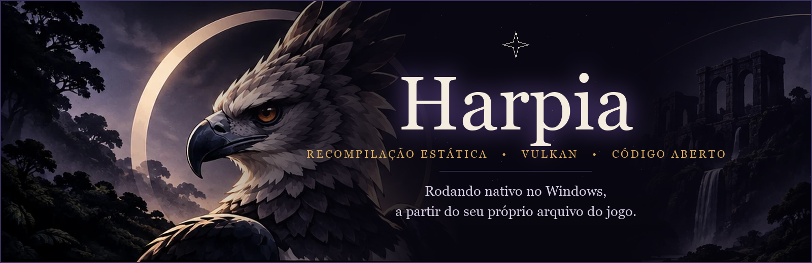

<p align="center">
  
</p>

<p align="center">
  <b>Português</b> &nbsp;·&nbsp; <a href="README.en.md">English</a>
</p>

<p align="center">
  
  
  
  
</p>

# Harpia

**Harpia** roda *The Legend of Zelda: Ocarina of Time* (versão Nintendo Switch 2) **nativamente no Windows, sem emulador**, a partir da **sua própria cópia do jogo**.

Não é um emulador: o código do jogo é traduzido para C **uma vez, no seu PC**, e compilado como um programa comum do Windows (recompilação estática). O software de sistema do console é reimplementado e os gráficos do Switch 2 são refeitos em Vulkan.

> [!IMPORTANT]
> ### Aviso legal
> - Este repositório **não contém o jogo**, nem partes dele, nem chaves, nem executável pronto. Tudo o que a compilação gera (`harpia.exe`, o código gerado, caches de shader, saves) é derivado do **seu** jogo e fica **no seu PC**. **Nunca compartilhe esses arquivos.**
> - Você precisa ter **uma cópia legítima do jogo**, extraída por você do seu próprio console. Este projeto **não explica como obter o jogo**, não descriptografa nada e não pede nem aceita chaves.
> - Harpia é um projeto de fã, **sem vínculo com a Nintendo e sem endosso dela**. *The Legend of Zelda* e *Ocarina of Time* são marcas registradas da Nintendo; os demais nomes pertencem aos seus donos.
> - Pedidos de ajuda que envolvam piratear o jogo serão fechados sem resposta.

## Índice

[O que é](#o-que-é-e-de-quem-é-o-trabalho) · [Estado atual](#estado-atual) · [Requisitos](#requisitos) · [Do seu arquivo ao jogo](#do-seu-arquivo-ao-jogo) · [Jogando e o menu F1](#jogando-e-o-menu-f1) · [Problemas conhecidos](#problemas-conhecidos) · [Roteiro](#roteiro) · [Como funciona](#como-funciona) · [Contribuir e pedir ajuda](#contribuir-pedir-ajuda-e-reportar-bugs) · [Créditos](#créditos-e-agradecimentos) · [Licença](#licença) · [Apoie o projeto](#apoie-o-projeto)

## O que é e de quem é o trabalho

A Harpia é uma **versão pessoal, com identidade própria**, do projeto de código aberto **[Hookshot](https://github.com/NotRexed/Hookshot)** (GPL-3.0-or-later), de **NotRexed e colaboradores**. **Quase todo o trabalho pesado vem dele**: o tradutor de ARM64 para C, o sistema Horizon reimplementado, a camada gráfica NVN2 e o recompilador de shaders. Sem esse projeto, a Harpia não existiria; veja os [créditos completos](CREDITS.md).

O que a Harpia acrescenta sobre a base:

- menu de opções **em abas, em português e inglês** (F1), com opções de ampliação, proporção, filtragem e ritmo de quadros;
- ampliadores **AMD FSR 1** e **NVIDIA NIS**, além de Linear, Catmull-Rom e Lanczos;
- um **cache de shaders mais robusto**: ele sobrevive a atualizações do programa, em vez de recomeçar do zero;
- correções do tradutor de shaders e um **detector de quadros escuros** para caçar as piscadas;
- trabalhos de desempenho de CPU e correções para placas AMD;
- o **Harpia Builder**, um aplicativo com janela que transforma o seu arquivo do jogo em uma pasta jogável;
- integração e teste contínuos das melhorias de outros projetos, sempre com os avisos de autoria mantidos.

O código de cada mudança fica neste repositório, sob a mesma licença da base.

## Estado atual

Harpia está **em desenvolvimento ativo**. O jogo roda e é jogável; ainda há arestas (veja [Problemas conhecidos](#problemas-conhecidos)). **Ainda não há instalador nem versão pronta para baixar.**

| Recurso | Estado |
|---|---|
| Jogo nativo em Windows, Vulkan 1.3 | Funciona |
| Menu em abas (F1), em pt-BR e inglês | Funciona |
| Ampliadores FSR 1 e NIS, Catmull-Rom, Lanczos | Funciona |
| Proporção (esticar, ajustar 16:9, preencher), tela cheia, VSync | Funciona |
| Filtragem anisotrópica (2x a 16x) | Funciona |
| Qualidade de textura (Normal, Alta e Ultra) | Funciona |
| Geração de quadros (2x a 8x) | Funciona; pode piscar em movimento rápido |
| Cache de shaders que sobrevive a atualizações | Funciona |
| Detector de quadros escuros (diagnóstico) | Funciona |
| Controles configuráveis (teclado e controle) | Funciona |
| Resolução de saída 2.5K nativa (2560x1440) | Funciona na TV (não no modo portátil); vale ao reiniciar; usa muita VRAM (cerca de 13 GB em testes), combine com textura Ultra |
| **DLSS** | **Em andamento** (análise concluída, código ainda não testado em GPU) |
| Instalador / pacote pronto do Builder | Planejado |

## Requisitos

- **Windows 10 ou 11, 64 bits.**
- **Placa de vídeo com Vulkan 1.3** (o jogo usa mesh shaders: placas com `VK_EXT_mesh_shader` são o alvo), com driver atualizado. O desenvolvimento e os testes são feitos principalmente em uma **NVIDIA GeForce RTX 5080**; há correções para AMD feitas a partir de relatos, e GPUs Intel não foram testadas.
- **16 GB de RAM ou mais** e cerca de **60 GB livres** durante a compilação.
- **Visual Studio Build Tools** com a carga "Desenvolvimento para desktop com C++" (compilador e Windows SDK).
- **A sua cópia do jogo, na versão suportada:** programa `0400486024DEC000`, atualização `v131072`, build `e0f3ccfa`. Outras versões são recusadas com uma mensagem clara.
- Para compilar a partir do código-fonte (e não pelo Builder empacotado): Python 3 com `lz4`, `numpy`, `capstone` e `zstandard` (e `unicorn` 2.1 só para os testes de instruções), mais o clang do emsdk. Detalhes em [docs/development.md](docs/development.md).

> [!NOTE]
> O repositório não guarda binários. As ferramentas pré-compiladas (`SDL2.dll`, `wgpu-native`) e os cabeçalhos baixados na compilação não estão no git; o pacote do Builder deve trazê-los (ainda não publicado).

## Do seu arquivo ao jogo

A Harpia lê o jogo **já descriptografado**, de um destes dois jeitos:

1. **Arquivo `.nup`**: pacote que contém, para cada título, as árvores `exefs/` e `romfs/` do jogo. Vale o título mais novo do pacote.
2. **Pastas `romfs` e `exefs`**: a mesma coisa, já extraída.

Os dois vêm de um *dump feito por você, do seu próprio jogo*, já descriptografado. Este projeto não ensina a fazer o dump. O `.nup` pode ter os arquivos guardados como estão ou comprimidos; o Builder lê os dois casos e também aceita que você **arraste o arquivo `.nup`** para a janela.

### Pelo Harpia Builder (janela)

1. Abra o `HarpiaBuilder`, escolha **Arquivo .nup** (ou **romfs e exefs**) e aponte para os seus arquivos.
2. O Builder confere se é o jogo e a versão certos e diz com palavras claras quando não for.
3. Escolha a pasta de destino (por exemplo `C:\Games\Harpia`) e o idioma do jogo (16 idiomas, incluindo pt-BR).
4. Aguarde: a tradução e a compilação rodam no seu PC e demoram. O progresso aparece por etapas.
5. Abra `harpia.exe` na pasta criada.

### Pela linha de comando

```powershell
# conferir só a versão do jogo (precisa das ferramentas de compilação já instaladas)
python -I nx2/make_game.py --check --nup "C:\caminho\seu-jogo.nup"

# construir a pasta do jogo
python -I nx2/make_game.py --nup "C:\caminho\seu-jogo.nup" --out "C:\Games\Harpia" --language pt-BR
python -I nx2/make_game.py --romfs "C:\caminho\romfs" --exefs "C:\caminho\exefs" --out "C:\Games\Harpia" --language pt-BR
```

A pasta de trabalho é `%LOCALAPPDATA%\HarpiaBuilder`. A pasta de saída contém tudo o que o jogo precisa e é iniciada com um duplo clique; nada volta para o repositório. Para refazer a pasta depois de uma atualização da Harpia: `python -I nx2/make_game.py --update <pasta do jogo>` (só funciona em pastas feitas por uma versão recente, que guardam uma cópia dos arquivos do jogo). O código de `--language` deve ser um dos 16 da lista do Builder, como `pt-BR` ou `en-US`.

Algo deu errado? Veja [SUPPORT.md](SUPPORT.md).

## Jogando e o menu F1

| Tecla | Ação |
|---|---|
| <kbd>F1</kbd> ou <kbd>Insert</kbd> | Menu de opções (no controle: Back + Start, ou Home; LB / RB trocam de aba) |
| <kbd>F11</kbd> | Tela cheia |
| <kbd>W</kbd> <kbd>A</kbd> <kbd>S</kbd> <kbd>D</kbd> e setas | Andar (analógico esquerdo) e girar a câmera: valores fixos. A aba Controles associa os botões do jogo |

Dentro do menu: <kbd>Q</kbd> / <kbd>E</kbd> trocam de aba, <kbd>↑</kbd> <kbd>↓</kbd> escolhem e <kbd>←</kbd> <kbd>→</kbd> mudam o valor.

| Aba | Opções |
|---|---|
| **Tela** | Tela cheia · Proporção (Esticar / Ajustar 16:9 / Preencher) · VSync (Desligado / Ligado / Desligado com cortes) · Contador de FPS |
| **Gráficos** | Escala de renderização (Auto, 100% a 33%) · Ampliação (Linear, Catmull-Rom, Lanczos, AMD FSR 1, NVIDIA NIS) · Nitidez · Filtragem de texturas (Jogo, 2x a 16x) · Qualidade de textura (Normal / Alta / Ultra) · Resolução de saída (2048x1152 / 2560x1440) · Névoa (Clássica / Do jogo) · Modo do console (Na TV / Portátil) |
| **Desempenho** | Geração de quadros (desligada, 2x a 8x) · Ritmo de quadros · Velocidade do jogo (Por quadro / Tempo real) |
| **Controles** | Associar botões do controle e teclas |
| **Info** | Placa de vídeo, saída, teclas e créditos |

Algumas opções (Proporção "Preencher", Qualidade de textura, Névoa, Modo do console) só valem **ao reiniciar**; o menu avisa.

### Arquivos criados ao lado do jogo

| Arquivo | O que é |
|---|---|
| `harpia_options.ini` | opções do menu e dos controles |
| `harpia_log.txt` | registro da última execução (quando aberto pelo ícone) |
| `harpia_programs.bin`, `harpia_pipelines.bin`, `harpia_vk_pipelines.bin`, `harpia_prepared.bin` | caches de shader: podem ser apagados, são refeitos |
| `harpia_shaders.bin` | lista de shaders do jogo, preparada antes de jogar |
| `harpia_env.txt` | opcional: linhas `NOME=VALOR` lidas como variáveis de ambiente |
| `user\save` | seus saves |
| `language.txt` | código do idioma do jogo (por exemplo `pt-BR`) |
| `image.bin`, `romfs\`, `.harpia_exefs` | **dados do SEU jogo**, usados pelo programa: **nunca compartilhe** |

Os caches e o log **derivam do jogo ou do seu PC**: não os anexe a relatórios sem olhar antes (veja [como reportar](CONTRIBUTING.md#reportar-um-bug)).

## Problemas conhecidos

- **Piscadas:** de vez em quando um quadro sai sem iluminação (silhuetas). Existe um detector (`RX_VK_DARKLOG`) e várias causas já foram descartadas; a causa raiz ainda é investigada.
- **Travadas na primeira vez:** os shaders de uma área nova são compilados durante o jogo. A partir da segunda execução, o cache evita quase tudo.
- **Folhagem escura em Kokiri** (samambaias, cipós): a correção do projeto original está incluída; a verificação visual continua.
- **Perda de dispositivo da GPU** (*device lost*), rara, observada em testes de desenvolvimento; uma causa provável foi corrigida e o caso segue em observação.
- **Geração de quadros** pode cintilar em movimento rápido, no HUD e em cortes de câmera.
- A saída padrão é 2048x1152; 2560x1440 é opcional (aba Gráficos) e testado quase só com textura Ultra: com textura Alta houve mais quadros escuros em testes.
- Sem instalador pronto; o build Linux existe no código mas **não é suportado**.

Achou outro? Veja [como reportar um bug](CONTRIBUTING.md#reportar-um-bug).

## Roteiro

**Concluído** (uma etapa por commit no histórico): saída 2.5K nativa e textura Ultra · atualização do projeto original (folhagem, iluminação, filmes) · correção de páginas liberadas durante a importação para a GPU · cache de shaders robusto (notas que sobrevivem a mudanças, marcador de falha) · correções do tradutor e detector de quadros escuros · desempenho de CPU.

**Em andamento:** DLSS (viável com vetores de movimento reconstruídos da câmera; as DLLs da NVIDIA são proprietárias e **não serão distribuídas** pelo projeto) · compilação de shaders em segundo plano · a causa das piscadas.

**Planejado:** pacote pronto do Harpia Builder · ajuste de cor e painel de desempenho · opção do Builder para usar mais CPU e RAM e acelerar a instalação · documentação técnica em português.

## Como funciona

1. `nx2/lift.py` traduz o código ARM64 do jogo para C.
2. `nx2/build.py` compila esse C junto com `host/`, que faz o papel do sistema do console.
3. `host/nvn_native.c` grava as chamadas gráficas NVN2 do jogo e `gpu/vk/` as reproduz em Vulkan.
4. Os shaders Ampere do Switch 2 são rebaixados para Maxwell e traduzidos para SPIR-V pelo recompilador de shaders do Eden.

```
nx2/         tradutor, compilação e ferramentas (Python)
host/        sistema do console reimplementado (C)
gpu/vk/      renderizador Vulkan e recompilador de shaders
builder/     Harpia Builder (WPF, .NET 8)
third_party/ componentes de terceiros, com as suas licenças
docs/        projeto técnico e imagens
tests/       testes que não precisam do jogo
```

Mais em [docs/development.md](docs/development.md) e [docs/design.md](docs/design.md) (em inglês).

## Contribuir, pedir ajuda e reportar bugs

- **Contribuir:** [CONTRIBUTING.md](CONTRIBUTING.md) (como compilar, ramos, commits, regras de teste em GPU e PRs).
- **Preciso de ajuda:** [SUPPORT.md](SUPPORT.md).
- **Achei um bug:** [abra uma issue](../../issues/new/choose) com o modelo de bug (placa, driver, Windows, `harpia_options.ini` e trecho do `harpia_log.txt`).
- **Segurança:** [SECURITY.md](SECURITY.md).
- **Convivência:** [CODE_OF_CONDUCT.md](CODE_OF_CONDUCT.md).

## Créditos e agradecimentos

Obrigado, de coração, a quem fez o trabalho mais difícil:

- **NotRexed** e os colaboradores do **[Hookshot](https://github.com/NotRexed/Hookshot)**, base de tudo aqui (recompilação, sistema, NVN2, a64-kit).
- **Eden**, **yuzu/suyu** e **Eglantine**: o recompilador de shaders e o trabalho com shaders do Switch 2.
- **sostenesfreitas/ocarina-recomp**, **Lichii**, **nxnative**, **MacNativeGames**, **TotK Recomp** e **dkb-pc-recomp**: pesquisa aberta e correções que guiam as nossas.
- **Ryujinx**, **zbic**, **AMD FidelityFX FSR** (MIT), **NVIDIA Image Scaling** (MIT), **SDL2**, **Vulkan Memory Allocator**, **Sirit**, **Opus** e muitos outros.

A lista completa, com links e licenças, está em **[CREDITS.md](CREDITS.md)** e em [NOTICE.md](NOTICE.md). Se o seu trabalho está aqui e o crédito está errado ou faltando, abra uma issue: corrigimos na hora.

## Licença

Harpia é software livre sob a **[GNU General Public License, versão 3 ou posterior](LICENSE)** (GPL-3.0-or-later), como o projeto em que se baseia. Partes de terceiros sob outras licenças compatíveis mantêm os seus avisos nas suas pastas; veja [NOTICE.md](NOTICE.md). Os comentários `(hookshot)` e `Hookshot issue/PR N` nos fontes são avisos de autoria e modificação exigidos pelas licenças: **não os remova**.

## Apoie o projeto

A Harpia é e continuará **gratuita**. Se quiser ajudar a manter o desenvolvimento, pode fazer uma doação voluntária por **PIX**:

<p align="center">
  
</p>


> Doações são voluntárias, **não compram acesso, o jogo nem suporte prioritário**, e não têm relação com a Nintendo. Considere também apoiar os projetos que tornam a Harpia possível (links em [CREDITS.md](CREDITS.md)).
